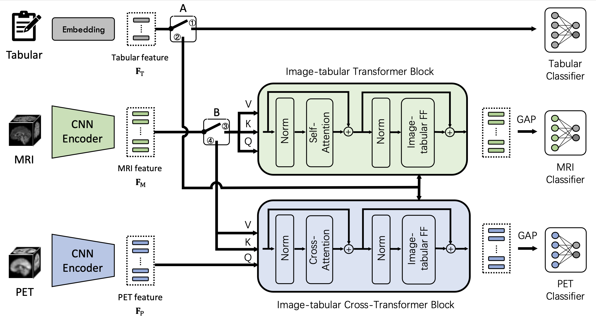

# MultimodalAD

A Modality-Flexible Framework for Alzheimer's Disease Diagnosis Following Clinical Routine

IEEE JBHI [Paper Link](https://ieeexplore.ieee.org/abstract/document/10702472/)



## Setup

Clone the repository and install the Python dependencies in a virtual environment:

```bash
git clone https://github.com/Kateridge/MultimodalAD.git
cd MultimodalAD
python -m venv .venv
source .venv/bin/activate  # Windows PowerShell: .venv\Scripts\Activate.ps1
python -m pip install torch monai pytorch-ignite numpy pandas scikit-learn nibabel einops vit-pytorch munch pycm shap catboost matplotlib
```

For GPU training, install a CUDA-compatible PyTorch build using the [official installation instructions](https://pytorch.org/get-started/locally/). 

## Dataset format

Prepare your own preprocessed images and tabular CSV files; datasets and fold splits are not included. The scripts read five folds from the following layout (run commands from the repository root):

```text
lookupcsvs/
  cross0/
    train.csv
    valid.csv
    test.csv
    exter_test.csv
  cross1/  # same files
  cross2/
  cross3/
  cross4/
```

Each CSV has a header and one row per subject/session. Required columns are:

| Column | Format |
| --- | --- |
| `path` | Dataset root directory accessible on the machine running the code, e.g., `/data/ADNI`. |
| `filename` | Subject/session identifier, e.g., `sub-ADNI001S0001_ses-M00` (without `.nii.gz`). The first two underscore-separated components determine the subject and session directories. |
| `FDG`, `AV45` | Numeric PET availability flags: `1` = available, `0` = unavailable. Both columns are required; the provided training scripts use `AV45`. |
| Task label | `COG` uses integer class indices `0`, `1`, `2`; `ADD` and `MCIC` use `0`, `1`. Include the column matching `--task`, with a consistent class mapping across splits. Rows with a missing task label are excluded. |
| Tabular features | The 37 columns below, matching the default `--tabular` list in `options.py`. Use numeric values; `gender` also accepts `male`/`female`, mapped to `0`/`1`. Leave missing values empty (NaN). |

```text
age, gender, education, apoe, trailA, trailB, boston, animal,
gds, mmse, npiq_DEL, npiq_HALL, npiq_AGIT, npiq_DEPD, npiq_ANX,
npiq_ELAT, npiq_APA, npiq_DISN, npiq_IRR, npiq_MOT, npiq_NITE,
npiq_APP, faq_BILLS, faq_TAXES, faq_SHOPPING, faq_GAMES, faq_STOVE,
faq_MEALPREP, faq_EVENTS, faq_PAYATTN, faq_REMDATES, faq_TRAVEL,
his_CVHATT, his_CBSTROKE, his_HYPERTEN, his_PSYCDIS, his_ALCOHOL
```

The loader selects features by name and creates missing-value masks automatically (`1` = observed, `0` = missing). Changing the feature list also requires updating the feature indices in `options.py` and the fixed feature slices in `datasets/GeneralDataset.py`.

Images must be 3D NIfTI volumes arranged as follows for each CSV row:

```text
<path>/
  sub-ADNI001S0001/
    ses-M00/
      t1/sub-ADNI001S0001_ses-M00.nii.gz
      av45/sub-ADNI001S0001_ses-M00.nii.gz  # required when AV45 = 1
```

MRI is loaded for every sample in the imaging pipeline. Unavailable PET is replaced with a zero tensor. The loader scales image intensities and center-crops to `160 × 192 × 160`.

## Running

After preparing the data, train and evaluate the default multimodal model:

```bash
python train.py --model CrossTransformer_IT --task COG --batch_size 2 --epochs 40 --num_workers 8
```

The script runs all five folds and evaluates each fold after training. Other task options include `ADD` and `MCIC`, provided the corresponding label column is present. 

View available arguments with `python train.py --help`. Results are saved under `checkpoints/<task>_<model>_<timestamp>/`, including `opt.txt`, fold-specific model files and `test_eval.csv`, and aggregate `results.npy`. To summarize results by cohort, edit `root_path`, `eval_task`, and `task_cohort_mapping` in `eval_performance.py`, then run `python eval_performance.py`; cohort grouping uses substrings in `filename`.

## Citation

If you use this code, please cite:

Yuanwang Zhang, Kaicong Sun, Yuxiao Liu, Fang Xie, Qihao Guo, and Dinggang Shen. “A Modality-Flexible Framework for Alzheimer's Disease Diagnosis Following Clinical Routine.” *IEEE Journal of Biomedical and Health Informatics*, 29(1):535–546, 2025. [doi:10.1109/JBHI.2024.3472011](https://doi.org/10.1109/JBHI.2024.3472011).

```bibtex
@article{zhang2025modality,
  title   = {A Modality-Flexible Framework for {Alzheimer's} Disease Diagnosis Following Clinical Routine},
  author  = {Zhang, Yuanwang and Sun, Kaicong and Liu, Yuxiao and Xie, Fang and Guo, Qihao and Shen, Dinggang},
  journal = {IEEE Journal of Biomedical and Health Informatics},
  year    = {2025},
  volume  = {29},
  number  = {1},
  pages   = {535--546},
  doi     = {10.1109/JBHI.2024.3472011}
}
```
